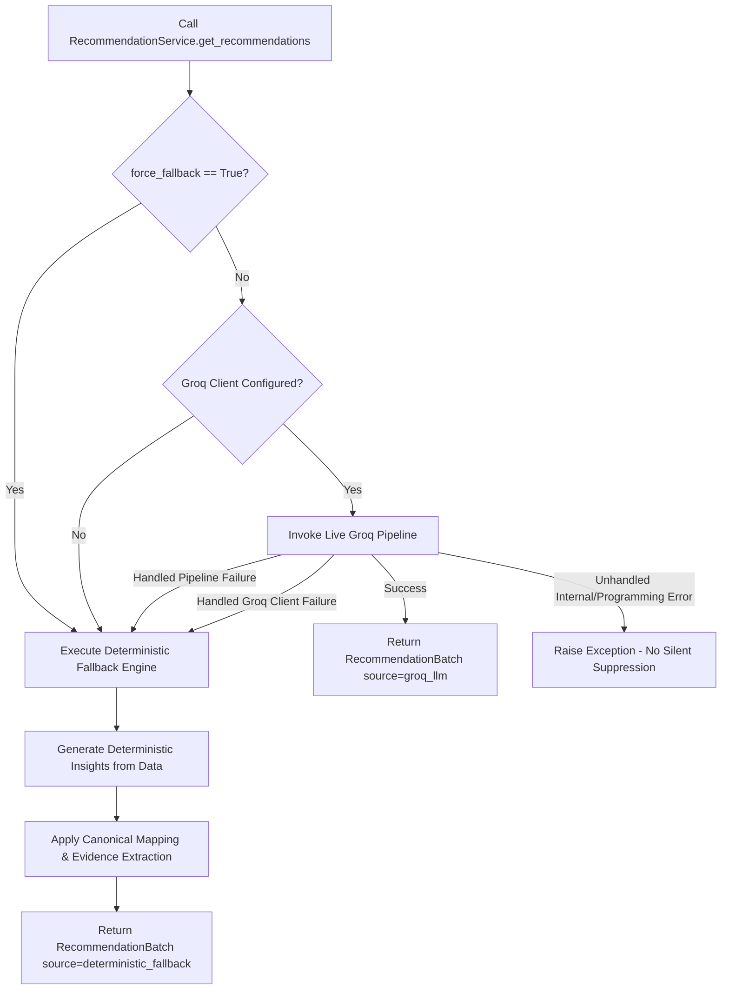

# Market Orbit — Phase 5.6: Deterministic Fallback Engine Report

## 1. Executive Summary

Phase 5.6 completes the deterministic fallback engine and unified recommendation architecture for Market Orbit. Following the completion of Phase 5.5 (Live Groq Inference Pipeline) and successful verification via offline fixtures and manual smoke testing, Phase 5.6 establishes a dependable, fault-tolerant path between live LLM generation and deterministic rule-based insights.

The implementation converts analytical insights produced by `generate_insights()` directly into canonical Phase 5.1 `RecommendationItem` objects attributed to `source="deterministic_fallback"`. It also introduces `RecommendationService`, a unified facade that attempts live Groq inference and automatically falls back to deterministic recommendations upon unconfigured client states, authentication failures, provider rate limits, network timeouts, or schema/parsing errors.

As constrained by the roadmap, `AnalysisService.get_results()`, database persistence, API endpoints, and frontend components remain untouched for Phase 5.7.

---

## 2. Initial Audit Findings

Prior to making changes, an audit of existing analytics and AI modules was conducted:

1. **`analytics/ai/schemas.py`**:
   - Canonical `RecommendationItem` supports controlled categories (`RecommendationCategory`) and sources (`RecommendationSource`).
   - `source="deterministic_fallback"` is already recognized as a valid enum member.
   - Pydantic models enforce strict numeric bounding: finite metrics, non-negative numbers, explicit null handling for missing revenue.
2. **`analytics/insights/generator.py`**:
   - Produces structured deterministic dictionaries:
     - `campaign_performance`: Top converter, zero-conversion spenders.
     - `cost_efficiency`: Lowest CPA, highest CPA.
     - `revenue_efficiency`: Top ROAS, lowest ROAS (or None if revenue missing).
     - `dimensional`: Top channel/dimension conversions and CPA.
     - `time_series`: Day-of-week / date trends.
     - `data_quality`: Tracking integrity and data hygiene notices.
3. **`analytics/ai/groq_client.py`**:
   - `GroqClient.is_configured` accurately reflects whether an API key is present.
   - Raises structured domain exceptions (`GroqClientError`, `GroqAuthenticationError`, `GroqRateLimitError`, `GroqAPIError`, `GroqTimeoutError`).
   - Retains a legacy `generate_recommendations()` method that returned mock fallback recommendations.
4. **`analytics/ai/pipeline.py`**:
   - Raises granular pipeline exceptions: `PipelineConfigurationError`, `PipelineAuthenticationError`, `PipelineProviderError`, `PipelineParsingError`, `PipelineValidationError`.
5. **Existing Tests**:
   - Baseline regression suite had 328 passing tests across analytics and backend.

---

## 3. Files Changed and Rationale

| File | Change Type | Rationale |
|---|---|---|
| [`analytics/ai/fallback.py`](file:///c:/Users/Vishal%20S%20Naik/MyProjects/market-orbit/analytics/ai/fallback.py) | New file | Implements deterministic insight-to-recommendation conversion (`map_insight_to_recommendation`, `convert_insights_to_recommendations`, `generate_fallback_recommendations`) using canonical schemas and evidence extraction without hallucinations. |
| [`analytics/ai/service.py`](file:///c:/Users/Vishal%20S%20Naik/MyProjects/market-orbit/analytics/ai/service.py) | New file | Implements unified `RecommendationService` orchestrating live Groq execution with automatic, safe fallback to deterministic insights upon any operational or configuration failure. |
| [`analytics/ai/__init__.py`](file:///c:/Users/Vishal%20S%20Naik/MyProjects/market-orbit/analytics/ai/__init__.py) | Modified | Re-exports Phase 5.6 classes and factory functions (`RecommendationService`, `generate_fallback_recommendations`, etc.) with PEP 484 type aliases. |
| [`analytics/tests/test_ai.py`](file:///c:/Users/Vishal%20S%20Naik/MyProjects/market-orbit/analytics/tests/test_ai.py) | Modified | Adds 11 focused test cases verifying mapping rules, missing vs. zero revenue semantics, source attribution, unified routing, error handling, and JSON serialization. |

---

## 4. Deterministic Insight-to-Category Mapping Rules

Every insight generated by `generate_insights()` is converted according to explicit, deterministic rules that map insight types and patterns to canonical `RecommendationCategory` values:

| Insight Type | Sub-Pattern / Condition | Mapped `RecommendationCategory` | Recommended Action Directive |
|---|---|---|---|
| `data_quality` | Missing revenue, zero conversions, missing dates | `DATA_TRACKING` | Audit pixel tracking, conversion hooks, and reporting feeds. |
| `campaign_performance` | Zero conversions with spend (`Zero conversions`) | `WASTE_REDUCTION` | Pause or restructure underperforming campaigns with zero conversion yield. |
| `campaign_performance` | Top converter / high volume | `CHANNEL_SCALING` | Scale budget or expand audience reach on proven high-conversion campaigns. |
| `cost_efficiency` | Highest CPA / inefficient cost per action | `WASTE_REDUCTION` | Cap bids, tighten audience targeting, or pause high-CPA campaigns. |
| `cost_efficiency` | Lowest CPA / highly efficient acquisition | `BUDGET_ALLOCATION` | Prioritize budget allocation toward low acquisition cost segments. |
| `revenue_efficiency` | Lowest ROAS / negative return | `WASTE_REDUCTION` | Review margin thresholds and reduce spend on low-ROAS assets. |
| `revenue_efficiency` | Top ROAS / high return on ad spend | `BUDGET_ALLOCATION` | Reallocate capital to maximize aggregate campaign revenue yield. |
| `dimensional` | Leading dimension conversions | `CHANNEL_SCALING` | Double down on best-performing channels and dimensions. |
| `dimensional` | Dimension lowest CPA | `BUDGET_ALLOCATION` | Shift cross-channel budgets toward high-efficiency dimensional segments. |
| `time_series` | Conversion date peak / creative timing | `CREATIVE_OPTIMIZATION` | Optimize ad scheduling and creative rotation to align with peak demand. |
| `time_series` | General pacing or timeline trajectory | `BUDGET_ALLOCATION` | Adjust dayparting and schedule budget releases during high-response periods. |

If an insight does not match any specific sub-pattern, a deterministic fallback category (`BUDGET_ALLOCATION` or `DATA_TRACKING`) is chosen based on the insight's primary focus.

---

## 5. Unified Service Success, Fallback, and Error Behavior

The `RecommendationService` orchestrates recommendations through `get_recommendations()`:



### Handled Failures Triggering Fallback
- `PipelineConfigurationError` (Missing API key, bad model config)
- `PipelineAuthenticationError` (Invalid or revoked API key, HTTP 401)
- `PipelineProviderError` (Provider 5xx, rate limits 429, socket timeouts)
- `PipelineParsingError` (Malformed JSON, invalid code blocks from model)
- `PipelineValidationError` (Schema violations, unknown categories, ungrounded source)
- `GroqClientError` (Any client-level transport or configuration failure)

### Unhandled Failures
Programming errors (e.g. `TypeError`, `KeyError` within unexpected application structures, invalid parameter arguments) and malformed insight data structures are not silently disguised as successful fallback. They are raised directly to preserve observability and prevent corruption.

### Source Attribution Safeguard
- Recommendations produced via Groq always carry `source="groq_llm"`.
- Recommendations produced via fallback always carry `source="deterministic_fallback"`.
- The service never claims fallback recommendations came from Groq.

---

## 6. Evidence Integrity and Semantic Preservation

1. **No Invented Metrics**:
   - `SupportingEvidence` objects contain only metrics extracted directly from the insight or calculated from the input records (`spend`, `revenue`, `conversions`, `roas`, `cpa`).
   - If a metric is absent or invalid, it is omitted rather than populated with default or arbitrary values.
2. **Missing vs. Zero Revenue Semantics**:
   - If revenue is missing (`None`) in the dataset, ROAS is preserved as `None` in supporting evidence, and revenue efficiency insights are not fabricated.
   - If revenue is explicitly `$0.00`, ROAS is computed as `0.0`, distinguishing zero yield from unmeasured yield.
3. **No Arbitrary Budget Multipliers**:
   - Action descriptions provide actionable strategic guidance based on observed metrics without fabricating arbitrary percentage shifts (e.g., no hardcoded "increase spend by 25%").

---

## 7. Test Results

### Focused AI Test Suite
```bash
pytest analytics/tests/test_ai.py -v
======================= 114 passed, 3 warnings in 1.63s =======================
```
All 114 AI tests passed, including the 11 new Phase 5.6 tests:
1. `test_fallback_conversion_all_supported_insight_types`
2. `test_fallback_missing_vs_zero_revenue_semantics`
3. `test_fallback_empty_insights_handling`
4. `test_fallback_malformed_insight_data_raises_error`
5. `test_unified_service_groq_unconfigured_routes_to_fallback`
6. `test_unified_service_groq_success_returns_live`
7. `test_unified_service_groq_failures_trigger_fallback`
8. `test_unified_service_force_fallback_flag`
9. `test_unified_service_get_recommendation_list_compatibility`
10. `test_fallback_batch_json_serialization_round_trip`
11. `test_package_exports_for_phase_5_6`

### Full Repository Test Suite
```bash
pytest -v
======================= 339 passed, 6 warnings in 4.22s =======================
```
Total tests increased from 328 to 339 with 0 failures and 0 regressions.

---

## 8. Scope and Boundary Confirmation

- `backend/app/services/analysis_service.py` was **not modified**.
- Database models, migrations, and ORM entities were **not modified**.
- FastAPI routes and endpoints were **not modified**.
- Frontend files were **not modified**.
- No live network calls were made during automated testing; all unit tests execute completely offline.
- Real API credentials were not logged, exposed, or committed.

---

## 9. Git Status and Next Steps

```text
On branch analytics
Changes not staged for commit:
	modified:   analytics/ai/__init__.py
	modified:   analytics/tests/test_ai.py

Untracked files:
	analytics/ai/fallback.py
	analytics/ai/service.py
	docs/analytics/PHASE_5_6_DETERMINISTIC_FALLBACK_REPORT.md
```

Phase 5.6 is complete. Awaiting review before proceeding to Phase 5.7 (Backend & AnalysisService Integration).
