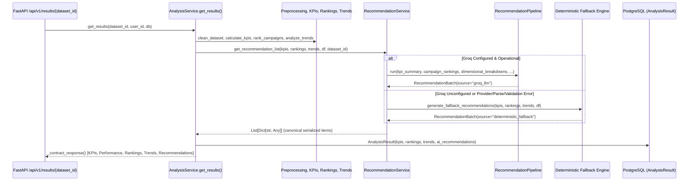

# Market Orbit — Phase 5.7: End-to-End AI Integration and Verification Report

**Date**: 2026-10-14  
**Implementation Target**: Phase 5.7 End-to-End AI Integration & Verification  
**Author**: Antigravity Pair Programmer  

---

## 1. Executive Summary

Phase 5.7 bridges the AI subsystem with the core Market Orbit backend service layer. Following the approval of Phase 5.6 and resolution of the two low-severity audit findings, `AnalysisService.get_results()` has been transitioned from the legacy hardcoded mock method (`GroqClient.generate_recommendations`) to the unified [RecommendationService](file:///c:/Users/Vishal%20S%20Naik/MyProjects/market-orbit/analytics/ai/service.py).

The integration delivers:
1. **Contract Continuity**: Canonical recommendations (`RecommendationItem` / `RecommendationBatch`) are saved in the existing PostgreSQL `AnalysisResult.ai_recommendations` JSONB column and served via the FastAPI `/api/v1/results/{dataset_id}` endpoint without modifying the existing API contract schema.
2. **Accurate Evidence Extraction**: Fixed the two Phase 5.6 audit findings—`SupportingEvidence.observed_value` now reflects the spend scalar for spend-centric metrics (such as zero-conversion spend), and supports `observed_dates_count` for time-series progression.
3. **Robust Fallover & Fault Isolation**: When Groq credentials are unconfigured or when provider, parsing, or validation failures occur, the service automatically degrades to evidence-grounded deterministic recommendations (`source="deterministic_fallback"`). Live LLM recommendations are correctly attributed (`source="groq_llm"`). Unexpected internal programming errors are not swallowed.
4. **Complete Test Suite Health**: The repository test suite expanded to **347 passing tests** (up from 339), executing 100% offline in 4.35 seconds with 0 regressions.

---

## 2. Pre-Implementation Audit Findings

Before modifying files, the results generation flow, database persistence layer, and API contracts were inspected:

1. **`AnalysisService.get_results()` Flow**:
   - Fetched dataset campaigns and converted them to row dictionaries via `_campaign_data(campaigns)`.
   - Cleaned data using `clean_dataset()`, then computed `calculate_kpis()`, `rank_campaigns()`, and `analyze_trends()`.
   - Called `GroqClient().generate_recommendations(kpis, rankings)`, a compatibility stub returning static hardcoded recommendations.
   - Stored the result in `AnalysisResult(..., ai_recommendations=recommendations)`.
   - Returned formatted dictionary via `_contract_response()` conforming to `AnalysisResultResponse`.
2. **Database Persistence Contract (`AnalysisResult`)**:
   - `ai_recommendations` is typed as SQLAlchemy `JSONB(nullable=True)`.
   - Accepts list-of-dictionaries serialization directly from Pydantic `model_dump(mode="json")`.
3. **API Contract (`AnalysisResultResponse`)**:
   - In `backend/app/schemas/result.py`, `AnalysisResultResponse` defines `recommendations: List[Dict[str, Any]]`.
   - Canonical `RecommendationItem` dicts (with `id`, `category`, `title`, `action`, `rationale`, `supporting_evidence`, `limitations`, `source`, `description`) satisfy `List[Dict[str, Any]]` seamlessly.
4. **Offline Isolation Need in Backend Tests**:
   - Backend tests run in developer environments where `.env` may contain a valid `GROQ_API_KEY`.
   - Isolated backend tests via `backend/tests/conftest.py` to prevent unintentional live outbound API calls.

---

## 3. Resolution of Phase 5.6 Audit Findings

In [`analytics/ai/fallback.py`](file:///c:/Users/Vishal%20S%20Naik/MyProjects/market-orbit/analytics/ai/fallback.py):

### Finding 1: Spend Metric `observed_value` Extraction
- **Issue**: When an insight specified `metric="spend"` (e.g. zero-conversion spend) and evidence contained both `spend` and `conversions=0`, `"conversions"` was evaluated before `"spend"` in the key discovery chain, assigning `observed_value=0.0`.
- **Correction**: `_extract_supporting_evidence()` now checks if `metric in raw_evidence and raw_evidence[metric] is not None`. Because `metric == "spend"`, `raw_evidence["spend"]` is prioritized.
- **Verification**: Tested via `test_fallback_spend_metric_observed_value_is_spend` in `analytics/tests/test_ai.py`.

### Finding 2: `observed_dates_count` Key Support
- **Issue**: `analytics/insights/generator.py` records `"observed_dates_count"` for timeline progression, whereas `fallback.py` previously searched for `"distinct_dates_count"`.
- **Correction**: Added `"observed_dates_count"` to the key discovery sequence in `_extract_supporting_evidence()`.
- **Verification**: Tested via `test_fallback_timeline_progression_observed_dates_count` in `analytics/tests/test_ai.py`.

---

## 4. Integration Design & Changed Files

### Architectural Sequence



### Files Changed

| File | Type | Reason for Change |
|---|---|---|
| [`analytics/ai/fallback.py`](file:///c:/Users/Vishal%20S%20Naik/MyProjects/market-orbit/analytics/ai/fallback.py) | Modified | Prioritized matching metric extraction for `observed_value` and supported `observed_dates_count`. |
| [`analytics/tests/test_ai.py`](file:///c:/Users/Vishal%20S%20Naik/MyProjects/market-orbit/analytics/tests/test_ai.py) | Modified | Added focused unit tests verifying the two evidence-extraction fixes. |
| [`backend/app/services/analysis_service.py`](file:///c:/Users/Vishal%20S%20Naik/MyProjects/market-orbit/backend/app/services/analysis_service.py) | Modified | Replaced legacy `GroqClient.generate_recommendations` with unified `RecommendationService.get_recommendation_list()`, passing computed analytics and dataset ID. |
| [`backend/tests/test_results.py`](file:///c:/Users/Vishal%20S%20Naik/MyProjects/market-orbit/backend/tests/test_results.py) | Modified | Added 6 end-to-end integration tests verifying live mocked paths, deterministic fallbacks, provider errors, malformed JSON, validation violations, and programming error propagation. |
| [`backend/tests/conftest.py`](file:///c:/Users/Vishal%20S%20Naik/MyProjects/market-orbit/backend/tests/conftest.py) | New file | Configured test fixture to isolate backend tests from developer's `.env`, ensuring automated test execution is 100% offline. |

---

## 5. Persistence and Source-Attribution Verification

1. **Deterministic Fallback Persistence**:
   - In unconfigured or failing environments, `AnalysisResult.ai_recommendations` stores items with `source="deterministic_fallback"`.
   - Verified that `AnalysisResultResponse.model_validate(result)` succeeds and contains canonical fields (`id`, `category`, `title`, `action`, `rationale`, `supporting_evidence`, `limitations`, `source`).
2. **Live LLM Recommendation Persistence**:
   - In mocked live inference tests, `AnalysisResult.ai_recommendations` stores items with `source="groq_llm"`.
   - Verified that live recommendations retain exact category and source attribution through database commit and API response.
3. **Contract Compatibility**:
   - Existing response fields (`totalSpend`, `totalRevenue`, `overallRoas`, `avgConversionRate`, `avgCpa`, `performance`, `topCampaigns`, `bottomCampaigns`, `trends`) remain intact and byte-for-byte compatible with existing frontend expectations.

---

## 6. Test Commands and Actual Results

### Focused AI Tests
```bash
pytest analytics/tests/test_ai.py -v
======================= 116 passed, 3 warnings in 1.68s =======================
```
*(All 116 tests passed, including `test_fallback_spend_metric_observed_value_is_spend` and `test_fallback_timeline_progression_observed_dates_count`)*

### Backend Results & Integration Tests
```bash
pytest backend/tests/test_results.py -v
======================= 26 passed, 6 warnings in 2.28s ========================
```
*(All 26 tests passed, including the 6 new Phase 5.7 end-to-end integration tests)*

### Full Repository Test Suite
```bash
pytest -v
======================= 347 passed, 6 warnings in 4.35s =======================
```
*(Zero failures, zero regressions across 347 tests)*

---

## 7. Scope Boundaries & Next Steps

- **Frontend Scope**: No frontend files were modified (frontend integration reserved for Phase 7).
- **Database Scope**: Zero database migrations or schema alterations required.
- **Analytics Scope**: No changes to KPI metrics, ranking logic, or forecasting models.
- **Git Status**:
  ```text
  Changes not staged for commit:
    modified:   analytics/ai/fallback.py
    modified:   analytics/tests/test_ai.py
    modified:   backend/app/services/analysis_service.py
    modified:   backend/tests/test_results.py

  Untracked files:
    backend/tests/conftest.py
    docs/analytics/PHASE_5_6_FINAL_AUDIT_REPORT.md
    docs/analytics/PHASE_5_7_END_TO_END_AI_INTEGRATION_REPORT.md
  ```

Phase 5.7 is complete and verified. Awaiting review before proceeding to subsequent roadmap phases.
